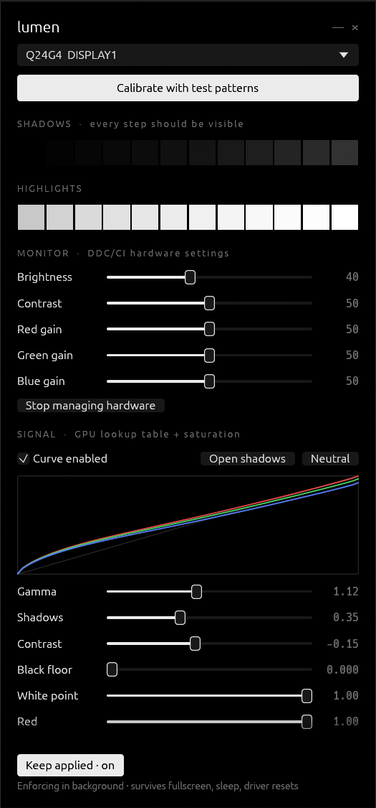
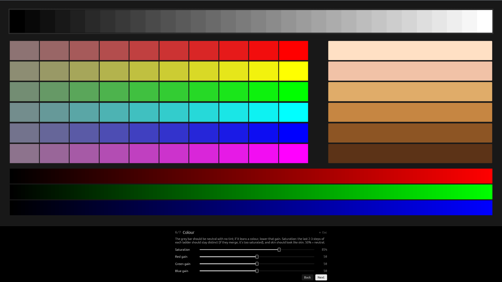
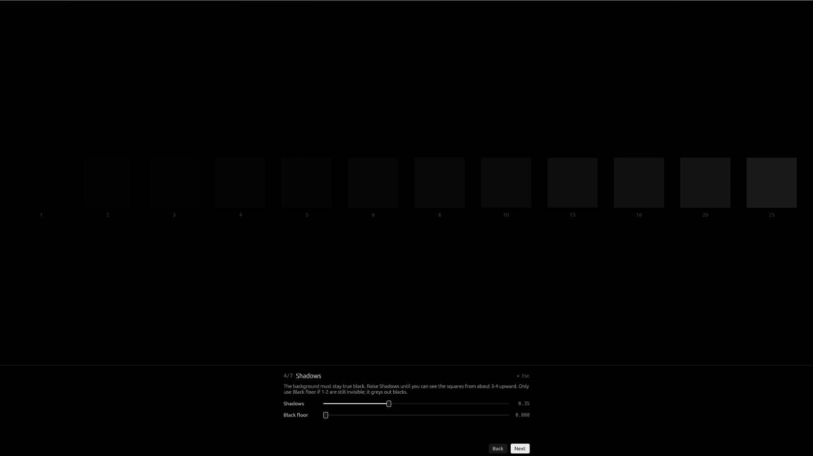
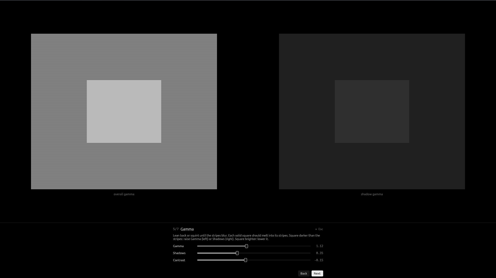
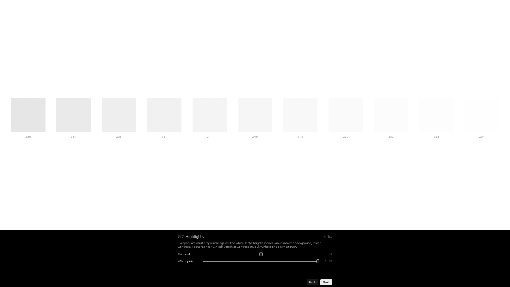

# lumen

<div align="center">
  
  <br>
  <b>Monitor calibration for Windows that changes your monitor's real settings and keeps them that way.</b>
  <br>
  No overlays. No colour filters. No settings silently reset by a game, a driver update or waking from sleep.
  <br><br>
  <a href="https://github.com/visiuun/lumen/releases/latest">
    
  </a>
  <br><br>
  
  
  
  
</div>

<br>

<p align="center">
  
  &nbsp;
  
</p>

<p align="center">
  
  
  
</p>

## At a glance

```text
Problem   Monitor looks crushed and over-contrasty, or bright and washed out. The OSD can't fix it.
          Fullscreen games, NVIDIA driver updates and sleep keep undoing whatever you set.

lumen     1. Run lumen.exe, click "Calibrate with test patterns", follow 7 short steps.
          2. Turn on "Keep applied".
          Done. It's written into the monitor itself and re-asserted whenever something resets it.
```

```powershell
lumen --probe          # what can lumen control on each monitor?
lumen --calibrate      # jump straight into the fullscreen wizard
lumen --apply          # apply the saved calibration once (scripts, shortcuts)
lumen --reset          # stop enforcing, return the GPU curve to neutral
```

## Why this exists

My monitor looked awful no matter what I did in its menu: either dark, crushed and oversaturated, or bright and washed out with no colour. Every "fix" was temporary. Launch a fullscreen game, update the NVIDIA driver or wake the PC, and the gamma was back to stock.

Most "calibration" tools for Windows are overlays: a translucent window painted over your screen. They can't add detail that the panel is crushing, they don't apply in exclusive fullscreen, and they cost you real contrast.

**lumen** drives the actual controls instead:

| Layer | What lumen writes | Where it lives |
| --- | --- | --- |
| **Monitor** | Brightness, contrast, RGB gains, any raw MCCS/VCP code | Inside the monitor over **DDC/CI** (the same channel as the OSD buttons), committed to its own memory |
| **Graphics card** | A per-channel transfer curve (gamma, shadows, contrast, black/white point, colour balance) | The GPU's **hardware gamma LUT**, applied to every pixel after composition |
| **NVIDIA driver** | Saturation | **Digital Vibrance** in the display pipeline (same setting as NVIDIA Control Panel) |

Then a tiny background enforcer (about 12 MB of RAM, no CPU to speak of) watches for everything that resets those layers and quietly puts your calibration back.

## Features

- **Real hardware control.** Brightness, contrast and RGB gain sliders talk to the monitor over DDC/CI and save into its NVRAM. An advanced panel can read or write any VCP code.
- **GPU curve editor** with a live curve plot: gamma, a shadow lift that recovers crushed near-blacks *without* greying out black, an S-curve or anti-S-curve contrast control, black floor, white point and per-channel balance.
- **Saturation** through NVIDIA Digital Vibrance.
- **Fullscreen calibration wizard** with pixel-exact test patterns: black level, white level, stripe-vs-solid gamma (overall and shadow), grey-ramp tint check, saturation ladders, skin tones and banding gradients.
- **Stays applied.** It survives fullscreen games, NVIDIA/AMD/Intel driver updates and reinstalls, sleep and resume, monitor power cycles, input switching, lock/unlock and display re-plugs. See [What survives what](#what-survives-what).
- **Per-monitor profiles**, keyed to the monitor's EDID device path rather than "Display 1", so they follow the monitor across ports, driver reinstalls and display reordering.
- **One 5 MB exe.** No installer, no runtime, no .NET, no VC++ redistributable, no admin rights.
- **Pure black UI** that sits quietly on OLED panels.

## Quick start

1. Download **`lumen-x64.exe`** from the [latest release](https://github.com/visiuun/lumen/releases/latest). Use `lumen-arm64.exe` for Snapdragon/ARM PCs and `lumen-x86.exe` for 32-bit Windows.
2. Run it. If SmartScreen appears, click **More info → Run anyway** (the exe isn't code-signed).
3. Click **Calibrate with test patterns** and follow the steps. Everything saves as you go.
4. Turn on **Keep applied**.

**Keep applied** copies lumen to `%LOCALAPPDATA%\lumen\`, registers it to start at logon (no admin, no scheduled task) and starts the enforcer. That's the whole install.

## The calibration wizard

Each step shows one fullscreen test pattern and only the controls that matter for it. Changes are live: the pattern you're looking at is going through the same GPU LUT and monitor settings you're adjusting.

| # | Step | Pattern | You adjust |
| --- | --- | --- | --- |
| 1 | **Baseline** | Neutral grey | Monitor contrast to factory default, then reset GPU curve and saturation to neutral |
| 2 | **Brightness** | White page on grey | Monitor brightness (backlight) for your room |
| 3 | **Highlights** | Levels 230 to 254 on white | Monitor contrast, white point |
| 4 | **Shadows** | Levels 1 to 25 on black | Shadows, black floor |
| 5 | **Gamma** | 1-pixel stripes vs. solid patches (2.2 target) | Gamma, shadows, curve contrast |
| 6 | **Colour** | Grey ramp, saturation ladders, skin tones, gradients | Saturation, RGB gains |
| 7 | **Check** | Black, gamma and white patterns together | Anything |

> **Tip:** before step 1, open your monitor's own menu and turn off anything "dynamic" or "enhanced": DCR/dynamic contrast, ECO and game picture modes, black stabiliser or shadow boost. These change the picture by themselves and will fight any calibration.

<details>
<summary><b>Example: taming a dark, over-contrasty IPS panel (AOC Q24G4)</b></summary>

Starting point: contrast 80 in the OSD, NVIDIA vibrance at 62%. The image was crushed and oversaturated, and dropping the contrast made it look washed out. A typical result after the wizard (your numbers will differ with room lighting and panel):

| Setting | Before | After |
| --- | --- | --- |
| Monitor contrast | 80 | **50** (factory; above this the panel clips) |
| Monitor brightness | 100 | **35** (dark room) |
| GPU gamma | 1.00 | **1.10** |
| GPU shadows | 0.00 | **0.30** |
| GPU curve contrast | 0.00 | **-0.10** |
| Saturation | 62% | **55%** |

The usual root cause is a high monitor contrast that clips both ends, combined with added saturation. Fixing contrast at the monitor and recovering shadows on the GPU side, instead of raising the black floor, keeps blacks black.

</details>

## What survives what

| Event | What normally happens | What lumen does |
| --- | --- | --- |
| Fullscreen game, video player or colour-profile loader replaces the gamma LUT | Calibration gone until reboot | LUT is checked **every second** and restored |
| NVIDIA/AMD/Intel driver update or reinstall | LUT and vibrance reset | Display-change events trigger a full re-apply at +1.5 s and again at +7 s |
| Sleep, hibernate, monitor powered off and on | LUT reset, some monitors drop settings | Resume and display-on events trigger a full re-apply |
| Monitor input switch, OSD fiddling, power cycle | Brightness/contrast drift | DDC/CI values are verified every 45 s and rewritten if they drift |
| Lock/unlock, Remote Desktop reconnect | LUT reset | Session events trigger a re-apply |
| Monitor moved to another port, displays reordered | Settings follow "Display 1", not the monitor | Profiles follow the monitor's EDID identity |

While the lumen window is open the enforcer steps aside, so it never fights your slider. It picks back up the moment you close the window.

## Using lumen

### Main window

- **Monitor (DDC/CI):** sliders write straight into the monitor. Moving an RGB gain switches the monitor to its *User* colour preset, because most monitors ignore gains in the other presets. **Stop managing hardware** forgets these values; the monitor keeps whatever it currently has.
- **Signal (GPU LUT + saturation):** the curve is drawn live. **Open shadows** is a good starting point for dark panels; **Neutral** resets it.
- **Shadows / Highlights strips:** quick visual checks. Every step should be distinguishable.
- **Advanced (raw VCP):** read or write any MCCS code in hex. Writes are remembered and re-applied like everything else.

### Command line

| Command | What it does |
| --- | --- |
| `lumen` | Open the app |
| `lumen --calibrate [N]` | Open the wizard fullscreen, optionally at step `N` (0-6) |
| `lumen --apply` | Apply the saved calibration once and exit |
| `lumen --daemon` | Run the background enforcer (Keep applied does this for you) |
| `lumen --probe` | Print, per monitor, what lumen can read and control |
| `lumen --reset` | Stop the enforcer and restore a neutral GPU curve |
| `lumen --uninstall` | Remove autostart, the installed copy and all settings |
| `lumen --help` | Show usage |

Example `--probe` output (one monitor):

```text
gamma range unlocked: false
enforcer running:     true

Q24G4 [\\.\DISPLAY1] primary
  id: \\?\DISPLAY#AOCB410#5&22d6f59e&0&UID24835#{e6f07b5f-ee97-4a90-b076-33f57bf4eaa7}
  gpu gamma ramp:   ok
  nvidia vibrance:  15/63
  brightness        35/100
  contrast          50/100
  colour preset     11/11
  red gain          50/100
  green gain        48/100
  blue gain         46/100
  saturation (8A)   no reply
  display mode (DC) 0/16
```

### Raw VCP examples

| Code | Value | Effect (on monitors that support it) |
| --- | --- | --- |
| `14` | `0B` | Colour preset: User 1 (needed for RGB gains) |
| `14` | `01` | Colour preset: sRGB |
| `DC` | `0` | Display mode: standard (turns off game/movie modes on many monitors) |
| `8A` | `50` | Saturation, if the monitor exposes it |
| `87` | `50` | Sharpness |

Use `--probe` or the **Read** button first. Codes vary between manufacturers, and some (like `60`, input select) will switch your screen to another input.

### Config file

Settings live in `%APPDATA%\lumen\config.json`. It's plain JSON, so you can back it up or copy it to another PC:

```json
{
  "enforce_hardware": true,
  "profiles": {
    "\\\\?\\DISPLAY#AOCB410#...": {
      "name": "Q24G4",
      "hardware": { "brightness": 35, "contrast": 50, "red": 50, "green": 48, "blue": 46, "extra": [] },
      "curve": { "enabled": true, "gamma": 1.1, "shadows": 0.3, "contrast": -0.1, "black": 0.0, "white": 1.0, "r": 1.0, "g": 1.0, "b": 1.0 },
      "vibrance": 6
    }
  }
}
```

A value of `null` means "leave this alone". The enforcer reloads the file within a second of it changing.

## How it works

```text
             config.json  (%APPDATA%\lumen)
                 │
     ┌───────────┴────────────┐
     │                        │
  lumen (app)          lumen --daemon (enforcer, hidden window)
  live preview         ├─ events: display change, device change, resume,
                       │  display on, unlock, DWM restart
                       ├─ every 1 s:  LUT + vibrance drift check
                       └─ every 45 s: DDC/CI drift check
     │                        │
     ├── DDC/CI ──────────────┤──▶ monitor registers + NVRAM   (dxva2: SetVCPFeature, SaveCurrentSettings)
     ├── GPU gamma LUT ───────┤──▶ graphics card output LUT     (gdi32: SetDeviceGammaRamp)
     └── NVAPI ───────────────┘──▶ NVIDIA Digital Vibrance      (nvapi64: SetDVCLevel)
```

- **DDC/CI writes are throttled and coalesced.** MCCS asks for at least 50 ms between commands, and many scalers silently drop writes that come faster. Slider drags are collapsed to the latest value per control.
- **The LUT curve** is built in floating point: contrast (smoothstep or inverse smoothstep), then gamma, a toe lift that peaks around 20% input and stays monotonic, then black/white mapping and channel gain. It's forced monotonic before upload because Windows rejects anything else.
- **Drift checks are tolerant.** Drivers quantise the LUT to 10-12 bits, so read-back is compared loosely and nothing gets rewritten in a loop.
- **The enforcer is a hidden top-level window**, not a message-only window, because message-only windows don't receive the broadcast messages that signal display changes. A named mutex keeps it single-instance.

## Compatibility

| | Works | Notes |
| --- | --- | --- |
| **Windows** | 10 and 11 | x64, ARM64 and x86 builds |
| **GPU curve** | Any GPU: NVIDIA, AMD, Intel | Ignored while Windows HDR is on (Windows limitation) |
| **Saturation** | NVIDIA | The slider is disabled on other GPUs |
| **Monitor controls** | Any monitor with DDC/CI (nearly all external monitors since about 2010) | Usually off over DisplayLink, many USB-C docks and KVMs. Laptop panels don't support DDC/CI, but the GPU curve still works |
| **Multiple monitors** | Yes | Each monitor has its own profile |
| **UI** | Any GPU with OpenGL 2.0+ | The enforcer itself needs no graphics API |

## Troubleshooting

<details>
<summary><b>"DDC/CI unavailable"</b></summary>

Turn on **DDC/CI** in the monitor's OSD (often under *Setup* or *Other*). Connect directly with DisplayPort or HDMI rather than through a dock, KVM or adapter. Run `lumen --probe` to see exactly which codes respond.
</details>

<details>
<summary><b>"Windows is refusing this curve"</b></summary>

By default Windows limits how far a gamma ramp can move from neutral. Click **Unlock full range** (one UAC prompt). It sets `GdiIcmGammaRange = 256` under `HKLM\SOFTWARE\Microsoft\Windows NT\CurrentVersion\ICM`. Sign out and back in afterwards.
</details>

<details>
<summary><b>Everything looks washed out, or crushed, over HDMI</b></summary>

The PC and monitor may disagree on the RGB range. In **NVIDIA Control Panel → Change resolution**, set **Output dynamic range** to **Full**. On AMD it's **Pixel Format: RGB 4:4:4 Full RGB**. Then recalibrate.
</details>

<details>
<summary><b>A game resets the picture for a second</b></summary>

Some games set their own gamma ramp when they start or when you touch their brightness slider. lumen restores yours within a second. If the game keeps re-asserting its ramp, leave its brightness setting at default.
</details>

<details>
<summary><b>The window doesn't open</b></summary>

The UI needs OpenGL 2.0 or newer. Update your graphics driver. In a VM or Remote Desktop session there may be no OpenGL at all. `--daemon`, `--apply` and the other command-line modes still work.
</details>

## Uninstall

Turn off **Keep applied** to stop the enforcer and remove autostart. To remove everything, including settings and the installed copy, run:

```powershell
lumen --uninstall
```

Monitor hardware settings stay as they are. Reset them from the monitor's own menu if you want factory values back.

## Build from source

```powershell
# Rust: https://rustup.rs (rust-toolchain.toml pins the toolchain, rustup installs it automatically)
git clone https://github.com/visiuun/lumen.git
cd lumen
cargo build --release
# → target\release\lumen.exe
```

Requirements: Windows with the MSVC build tools (*Desktop development with C++*, or just *MSVC* and the *Windows SDK*). The C runtime is linked statically, so the exe runs on a clean Windows install.

Other targets:

```powershell
rustup target add aarch64-pc-windows-msvc   # needs the MSVC ARM64 build tools
cargo build --release --target aarch64-pc-windows-msvc
```

Every push is built by [GitHub Actions](.github/workflows/build.yml) for x64, ARM64 and x86. Release binaries are built and attached by the same workflow.

## License

**[CC BY-NC 4.0](LICENSE)**. You're free to use, share, modify and build on lumen, as long as you:

- **credit** Visiuun and link back to this repository, and
- **don't use it commercially** (no selling it, bundling it in paid products, or using it for paid services).

For commercial licensing, open an issue.

## Credits

Created by [Visiuun](https://github.com/visiuun).
Built because one cheap monitor refused to look right.
